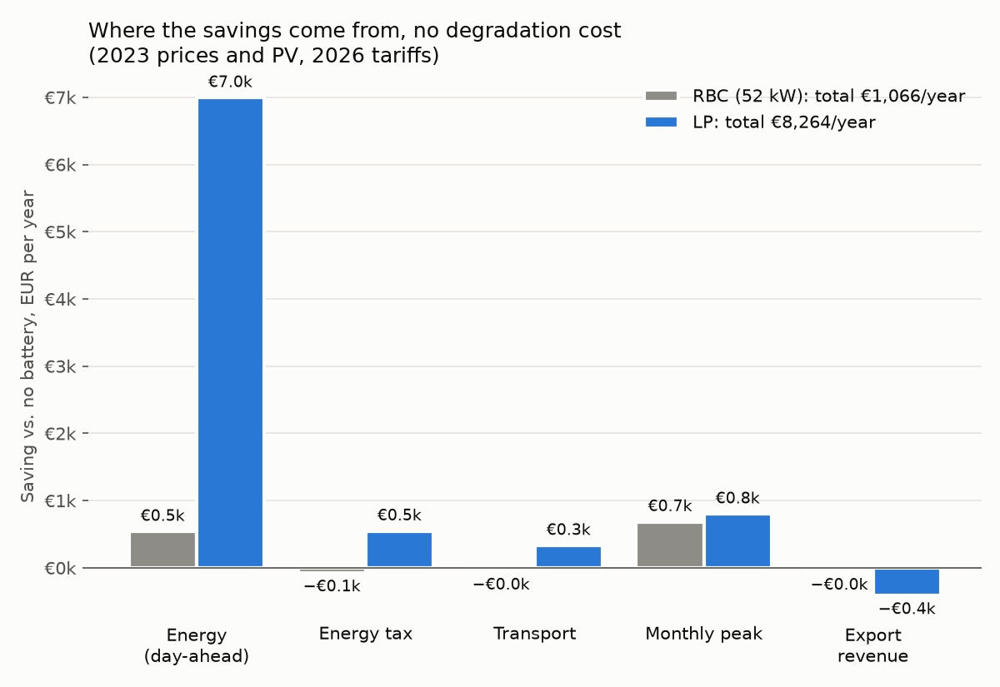

# bess-office

**Same battery, different control: rule-based control saves €1,066/year, optimization up to €8,264
(upper bound). The value is in arbitrage, not peak shaving.**

An open, transparent model for operating a battery (BESS) in an SME office building with a
large-consumer grid connection (grootverbruik). At quarter-hour resolution over a full year, it compares:

- **no battery**: the reference;
- **RBC** (rule-based control): peak shaving with grid charging, threshold chosen for the lowest annual cost;
- **LP**: linear optimization (Pyomo + HiGHS) that minimizes all cost components simultaneously.

The inputs are public data: PVGIS (simulated PV), ENTSO-E (actual day-ahead prices NL) and the Liander
standard profile for large-consumer offices (consumption). Every assumption has an ID in [`ASSUMPTIONS.md`](ASSUMPTIONS.md).

## Reference case

A hypothetical office building, not a real site: consumption comes from a standard profile scaled to
a typical Dutch office (DATA-8), PV is simulated for Delft. The battery is a commercially available
product, the Boltainer BOLT-241; its efficiency and SoC limits are typical LFP values (DATA-9).

| Component | Value |
|---|---|
| Building | 4,500 m² office, 517.5 MWh/year, peak demand 99.4 kW |
| PV | 190 kWp, south, 12° → 186.6 MWh/year |
| Battery | Boltainer BOLT-241: 241 kWh / 99 kW, 90% round-trip efficiency (loss applied on charging), SoC 10–95% |
| Prices | ENTSO-E day-ahead NL 2023 |
| Tariffs | transport €0.0226/kWh, monthly peak €3.57/kW, energy tax (energiebelasting) €0.03735/kWh (marginal bracket, 2026 rate) |

## Results (2023)

Net annual cost = energy + transport + energy tax + monthly peak − export. The sensitivity below
adds a degradation cost per kWh discharged from the battery (BAT-10).

| | No battery | RBC (52 kW) | LP |
|---|---:|---:|---:|
| Net cost (degradation cost 0) | €64,623 | €63,558 | €56,360 |
| **Savings (degradation cost 0)** | – | **€1,066** | **€8,264** |
| Annual peak import (degradation cost 0) | 96.5 kW | 96.5 kW | 86.8 kW |
| Full cycles/year (degradation cost 0) | – | 102 | 486 |

The LP knows the entire year in advance: **€8,264 is a theoretical upper bound**, not an achievable saving.
Payback period: not yet calculated (investment costs are not in the model yet).

### Sensitivity: degradation cost (BAT-10)

Battery wear priced per kWh discharged, applied with the same formula to RBC and LP. Central value
€0.04/kWh = replaceable hardware (~€200/kWh × 241 kWh) / (6,000 cycles × 204.85 usable kWh). The
LP is re-solved per value; the RBC dispatch (and its 52 kW threshold) stays the same, only its
costs are recalculated. €0 means wear is free (calendar ageing dominates); €0.06/kWh is a stress
case, e.g. a cycle life of 4,000 instead of 6,000 cycles (~€0.059/kWh).

| Degradation cost | Savings RBC | Savings LP | LP cycles/year |
|---:|---:|---:|---:|
| €0.00/kWh | €1,066 | €8,264 | 486 |
| €0.02/kWh | €646 | €6,571 | 358 |
| **€0.04/kWh** | **€226** | **€5,304** | **268** |
| €0.06/kWh | −€194 | €4,313 | 218 |




## Findings

- **The control strategy makes the difference.** With the same battery, the RBC saves €1,066 and the LP €8,264.
- **The value lies in arbitrage, not in peak reduction.** Of the LP savings, ~€6,600 comes from
  day-ahead energy, ~€900 from transport and tax, and ~€800 from the monthly peak. Even eliminating all
  peak costs would yield at most €3,776/year.
- **The RBC does not lower the annual peak.** An office's winter peak is broad: the usable
  205 kWh is depleted before the end of the working day. Only in April–August does the RBC hold 52 kW.
- **Self-consumption and peak shaving compete for the same SoC.** Grid charging keeps the battery full
  for the next peak, but leaves less room for PV: at the same threshold, the RBC with
  grid charging is even slightly more expensive than without. In a rule that trade-off is hidden; in the LP it is explicit.
- **Pricing wear cuts cycling more than savings, but only for the LP.** At €0.04/kWh the LP
  cycles 45% less (486 → 268) and keeps 64% of its savings (€5,304): it drops the least profitable
  cycles. The RBC does not look at costs, so it pays the full wear cost on its 102 cycles: its
  savings fall to €226 and turn negative at €0.06/kWh (with its threshold fixed at 52 kW).

## Limitations

- **Dynamic (day-ahead) contract assumed:** the logical contract for arbitrage. Behind a fixed-price
  contract the ~€6,600 arbitrage component does not apply (NET-7).
- **Perfect foresight:** the LP result is an upper bound (TIME-2).
- **Degradation only as a sensitivity:** the headline results have free wear (BAT-3). At the central
  €0.04/kWh, savings fall to €226 (RBC) and €5,304 (LP) (BAT-10). That value counts hardware only
  and attributes all wear to cycling, an upper bound if calendar ageing dominates; capacity fade
  itself is not modeled, and the RBC threshold is not re-chosen per degradation cost.
- **One price year, in-sample:** not tested whether other years turn out higher or lower (NET-4).
- **Smoothed consumption profile:** an average of many buildings, so the value of peak reduction
  is probably underestimated (DATA-7).
- **Energy tax at the marginal rate:** the higher rates on the first 50,000 kWh are paid in every
  scenario, so savings are unaffected, but absolute net costs are understated (NET-5).
- **Battery specs not verified:** efficiency and SoC range are typical LFP values (DATA-9). Grid
  tariffs are verified against the Liander 2026 tariff sheet (NET-8).
- **Not modeled:** contracted transport capacity (GTV, NET-8), lower export price (NET-9), and simultaneous
  charging/discharging at negative prices is measured but not excluded (BAT-8, ≤ €270/year).

## Data

The input data for the 2023 reference case is included in `data/raw/`, so the model runs without
downloads or API keys:

| File | Source |
|---|---|
| `KO_KANTOOR_ONDERWIJS_clean_2023_semicolon.csv` | [Liander open data](https://www.liander.nl/over-ons/open-data), dataset "Verbruiksprofielen grootverbruikaansluitingen elektriciteit": K&O standard profile for offices |
| `pvgis_*.csv` | [PVGIS](https://joint-research-centre.ec.europa.eu/pvgis-online-tool_en) (EU JRC), simulated PV for the reference system |
| `entsoe_prices_NL_*.csv` | [ENTSO-E Transparency Platform](https://transparency.entsoe.eu/), day-ahead prices NL |

For other PV configurations, PVGIS is queried automatically (no key needed). Other price years
require a free ENTSO-E API key: register on the Transparency Platform, request API access by email
to the Transparency helpdesk, and set it as `ENTSOE_API_KEY`.

## Running

Requirements: [uv](https://docs.astral.sh/uv/) and Python ≥ 3.12. All dependencies, including the
HiGHS solver, are installed by `uv sync`.

```bash
uv sync
uv run main.py   # no battery, RBC, LP + degradation sensitivity → costs + plots (~60 s)
uv run pytest
```

## Next steps

The key open question: how much of the €8,264 remains without perfect knowledge of the future?

- **Rolling-horizon optimization:** optimize daily over 24–48 hours using forecasts.
- **Sensitivity to noise:** savings under increasing errors in price, PV and consumption forecasts.
- **GTV and congestion:** the value of a smaller grid connection.
- **More years:** other price years, RBC threshold out-of-sample.
- **Real building data:** replace the averaged standard profile with the measured consumption of a
  single building, to test whether the value of peak reduction is underestimated (DATA-7).

## How this project was built

The problem definition, the reference case, the choice of RBC vs. LP, the degradation sensitivity and the interpretation of the results are my own. I used Claude Code as a programming assistant for part of the implementation, tests and documentation. I have checked every modeling choice and assumption (see ASSUMPTIONS.md) myself and can justify them.