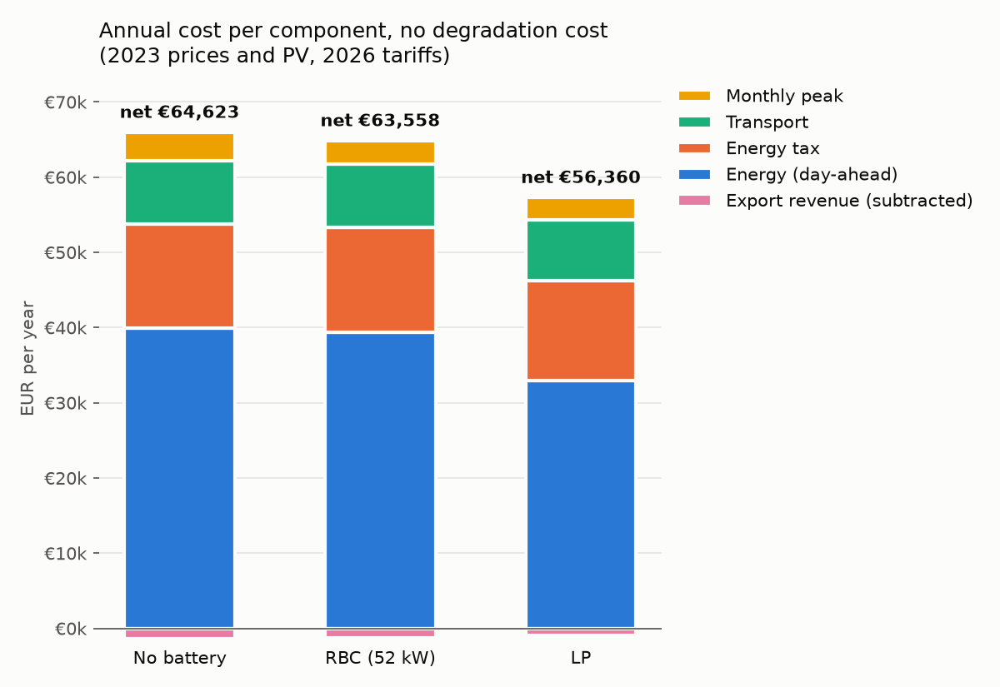

# bess-office

**Same battery, different control: rule-based control saves €1,066/year, optimization up to €8,264
(upper bound). The value is in arbitrage, not peak shaving.**

An open, transparent model for operating a battery (BESS) in an SME office building with a
large-consumer grid connection (grootverbruik). At quarter-hour resolution over a full year, it compares:

- **no battery**: the reference;
- **RBC** (rule-based control): peak shaving with grid charging, threshold chosen for the lowest annual cost;
- **LP**: linear optimization (Pyomo + CBC) that minimizes all cost components simultaneously.

The inputs are real data: PVGIS (PV), ENTSO-E (day-ahead prices NL) and the Liander standard profile
for offices (consumption). Every assumption has an ID in [`ASSUMPTIONS.md`](ASSUMPTIONS.md).

## Reference case
A hypothetical office building, not a real site: consumption comes from a standard profile scaled to
a typical Dutch office (DATA-8), PV is simulated for Delft. The battery is a commercially available
product, the Boltainer BOLT-241; its efficiency and SoC limits are typical LFP values (DATA-9).

| Component | Value |
|---|---|
| Building | 4,500 m² office, 517.5 MWh/year, peak demand 99.4 kW |
| PV | 190 kWp, south, 12° → 186.6 MWh/year |
| Battery | 241 kWh / 99 kW (BOLT-241), 90% charging efficiency, SoC 10–95% |
| Prices | ENTSO-E day-ahead NL 2023 |
| Tariffs | transport €0.0226/kWh, monthly peak €3.57/kW, energy tax (energiebelasting) €0.03735/kWh |

## Results (2023)

Net annual cost = energy + transport + energy tax + monthly peak − export. Scenario B adds a
hypothetical energy tax on every kWh that goes into the battery (NET-6).

| | No battery | RBC (52 kW) | LP |
|---|---:|---:|---:|
| Net cost A | €64,623 | €63,558 | €56,360 |
| **Savings A** | – | **€1,066** | **€8,264** |
| **Savings B** | – | **€191** | **€5,222** |
| Annual peak import (A) | 96.5 kW | 96.5 kW | 86.8 kW |
| Full cycles/year (A) | – | 102 | 487 |

The LP knows the entire year in advance: **€8,264 is a theoretical upper bound**, not an achievable saving.
Payback period: not yet calculated (investment costs are not in the model yet).



## Findings

- **The control strategy makes the difference.** With the same battery, the RBC saves €1,066 and the LP €8,264.
- **The value lies in arbitrage, not in peak reduction.** Of the LP savings, ~€6,600 comes from
  day-ahead energy, ~€900 from transport and tax, and ~€800 from the monthly peak. Even eliminating all
  peak costs would yield at most €3,776/year.
- **The RBC does not lower the annual peak.** An office's winter peak is broad: the usable
  205 kWh is depleted before the end of the working day. Only in April–August does the RBC hold 52 kW.
- **Self-consumption and peak shaving compete for the same SoC.** Grid charging keeps the battery full
  for the next peak, but leaves less room for PV: at the same threshold, the RBC with
  grid charging is even slightly more expensive than without. In a rule that trade-off is hidden; in the LP it is explicit.
- **A tax on storage weighs heavily.** Scenario B costs the LP ~37% and the RBC ~82% of its savings.

## Limitations

- **Perfect foresight:** the LP result is an upper bound (TIME-2).
- **No degradation cost:** battery wear is free in the model (BAT-3). Since wear scales mainly
  with energy throughput, this favours the LP most: it runs 487 full cycles/year versus 102 for
  the RBC. The LP savings are therefore optimistic on two counts: perfect foresight and free cycling.
- **One price year, in-sample:** not tested whether other years turn out higher or lower (NET-4).
- **Smoothed consumption profile:** an average of hundreds of buildings, so the value of peak reduction
  is probably underestimated (DATA-7).
- **Tariffs and battery specs not verified:** all euro amounts are indicative (DATA-9).
- **Not modeled:** contracted transport capacity (GTV), lower export price (ARCH-5), and simultaneous
  charging/discharging at negative prices is measured but not excluded (BAT-8, ≤ €270/year).

## Running

Requirements: [uv](https://docs.astral.sh/uv/), Python ≥ 3.12 and the CBC solver
(`apt install coinor-cbc` or `conda install -c conda-forge coincbc`).

```bash
uv sync
export ENTSOE_API_KEY=...   # only needed if the prices are not cached yet
uv run main.py              # no battery, RBC, LP (A and B) → costs + plot (~40 s)
uv run pytest
```

The Liander profile (`KO_KANTOOR_ONDERWIJS_clean_2023_semicolon.csv`) must be placed manually in `data/raw/`.
PVGIS and ENTSO-E data are fetched and cached on the first run.

## Next steps

The key open question: how much of the €8,264 remains without perfect knowledge of the future?

- **Rolling-horizon optimization:** optimize daily over 24–48 hours using forecasts.
- **Sensitivity to noise:** savings under increasing errors in price, PV and consumption forecasts.
- **Degradation cost:** a cost per kWh of throughput in the objective, to see how many cycles
  and how much of the savings remain once wear is priced in.
- **GTV and congestion:** the value of a smaller grid connection.
- **More years:** other price years, RBC threshold out-of-sample.

## How this project was built

The problem definition, the reference case, the choice of RBC vs. LP, scenario B and the interpretation of the results are my own. I used Claude Code as a programming assistant for part of the implementation, tests and documentation. I have checked every modeling choice and assumption (see ASSUMPTIONS.md) myself and can justify them.